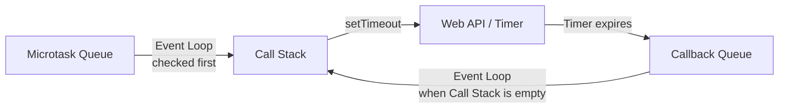

# JavaScript Notes

## Topics

1. Global Execution Context
2. Hoisting and Temporal Dead Zone (TDZ)
3. Call Stack, Event Loop and Queues

---

## Global Execution Context

The **Global Execution Context (GEC)** is the default execution environment created by the JavaScript engine when a script starts running. It represents the environment for code that sits outside of any function.

### Phases

|Phase|Also called|What happens|
|---|---|---|
|**1. Creation Phase**|Memory Creation, Memory Allocation, Setup Phase|Memory is allocated for variables and functions. `var` variables are initialized with `undefined`. Function declarations are stored with their complete function definition. The execution environment is set up.|
|**2. Execution Phase**|Thread / Code Phase|Code runs line by line. Variables are assigned their actual values. Functions are invoked when execution reaches the call.|

### Example

```js
console.log(`The Value of ${x}`); // The Value of undefined
var x = 10;

greet(); // Hello
function greet() {
  console.log("Hello");
}
```

```
        GEC
         │
   ┌─────┴─────┐
   ↓           ↓
Creation     Execution
Phase        Phase
   │           │
x → undefined  │
greet → fn     ↓
        console.log(x)
        → undefined
               │
               ↓
            x = 10
```

### Important

- The GEC is associated with the global environment and generally remains available for the lifetime of the JavaScript environment (for example, a page/realm). It is not destroyed immediately after the script finishes.
- When a function is invoked, JavaScript creates a **Function Execution Context** for it, with a similar creation and execution process.

---

## Hoisting and Temporal Dead Zone (TDZ)

### Hoisting

**Hoisting** is the behavior where declarations are processed during the creation/setup phase, before the code is executed.

It is often explained as "JavaScript moves declarations to the top of their scope," but **JavaScript does not literally move the code**.

| Declaration            | Hoisted? | Initial state                |
| ---------------------- | -------- | ---------------------------- |
| `var`                  | Yes      | Initialized with `undefined` |
| `let`                  | Yes      | **Uninitialized** (TDZ)      |
| `const`                | Yes      | **Uninitialized** (TDZ)      |
| `class`                | Yes      | **Uninitialized** (TDZ)      |
| `function` declaration | Yes      | Complete function definition |

> **Note:** `var`, `let` and `const` are all processed during the creation phase. `var` is initialized with `undefined`, while `let` and `const` stay uninitialized until execution reaches their declaration.

### Example

```js
console.log(a); // undefined
var a = 5;

sayHi(); // Hi
function sayHi() {
  console.log("Hi");
}
```

### Edge case: function expressions

Only the variable is hoisted, not the function assigned to it.

```js
hello(); // TypeError: hello is not a function
var hello = function () {};
```

### Temporal Dead Zone (TDZ)

The **Temporal Dead Zone (TDZ)** is the period between entering the scope of a `let`, `const` or `class` declaration and the point where that declaration is initialized.

During the TDZ, accessing the variable throws a `ReferenceError`.

```js
console.log(x); // ReferenceError: Cannot access 'x' before initialization
const x = 10;
```

```
Scope starts
     │
     ↓
┌──────────────────────┐
│ Temporal Dead Zone   │
│                      │
│ x exists             │
│ x is uninitialized   │
│                      │
│ Accessing x ❌       │
└──────────┬───────────┘
           │
           ↓
      const x = 10
           │
           ↓
      x is initialized
           │
           ↓
      Accessing x ✅
```

### Edge case: `typeof` in the TDZ

`typeof` is not safe for `let`, `const` or `class` inside the TDZ.

```js
console.log(typeof y); // ReferenceError: Cannot access 'y' before initialization
let y = 1;

console.log(typeof z); // "undefined" (undeclared variable, no error)
```

---

## Call Stack, Event Loop and Queues

### Call Stack

The **Call Stack** is a **LIFO (Last In, First Out)** data structure used by JavaScript to keep track of function execution.

```js
function a() { b(); }
function b() { c(); }
function c() { console.log("c"); }
a();
// Stack: a → b → c, then c pops first, then b, then a
```

**Edge case:** infinite recursion exceeds the stack limit and throws `RangeError: Maximum call stack size exceeded` (Stack Overflow).

### Web API / Host Environment

The **Web API** provides browser features such as timers, DOM APIs and network requests. These are provided by the **host environment**, not by the JavaScript engine itself.

### Task Queues

Once an asynchronous operation (for example `setTimeout()` or a `fetch()` response) is ready, its callback is placed in a queue. There are two types:

|Queue|Also called|Typical sources|
|---|---|---|
|**Microtask Queue**|Job Queue|`Promise.then/catch/finally`, `queueMicrotask()`, `MutationObserver`|
|**Callback Queue**|Task Queue, Macrotask Queue|`setTimeout`, `setInterval`, DOM events|

**Priority rule:** the Microtask Queue has higher priority than the Callback Queue. After the Call Stack becomes empty, the Event Loop runs microtasks until the Microtask Queue is empty, and only then picks the next task from the Callback Queue.

For example, if both queues have tasks and the Callback Queue task arrived first, the Event Loop still pushes the microtask to the Call Stack first.

**Task Starvation:** if microtasks keep adding new microtasks infinitely, the Microtask Queue never becomes empty, so the Callback Queue tasks are never pushed to the Call Stack.

```js
// Task Starvation: the setTimeout callback never runs
setTimeout(() => console.log("never runs"), 0);

function loop() {
  Promise.resolve().then(loop); // keeps adding a new microtask
}
loop();
```

### Event Loop

The **Event Loop** continuously checks whether the Call Stack is empty. If it is empty, it moves a ready task from a queue to the Call Stack for execution (microtasks first, then callbacks).

### Example 1: `setTimeout`

```js
console.log("Log 1");

setTimeout(() => {
  console.log("Log 2");
}, 0);

console.log("Log 3");

/*
 * Output
 * Log 1
 * Log 3
 * Log 2
 */
```

**Execution**

1. `console.log("Log 1")` executes → **Log 1**
2. `setTimeout()` registers the timer with the **Web API / host environment**.
3. JavaScript continues executing without waiting.
4. `console.log("Log 3")` executes → **Log 3**
5. Once the timer expires, its callback moves to the **Callback Queue**.
6. When the **Call Stack is empty**, the Event Loop moves the callback to the Call Stack.
7. Callback executes → **Log 2**

### Example 2: Microtask vs Callback Queue

```js
console.log("Log 1");

setTimeout(() => console.log("Log 2 (Callback Queue)"), 0);

Promise.resolve().then(() => console.log("Log 3 (Microtask Queue)"));

console.log("Log 4");

/*
 * Output
 * Log 1
 * Log 4
 * Log 3 (Microtask Queue)
 * Log 2 (Callback Queue)
 */
```

The `setTimeout` callback was registered first, but the Promise callback runs first because the Microtask Queue has higher priority.

### Diagram



### Interview Point ⭐

> `setTimeout(callback, 0)` does **not** execute immediately. The callback runs after the timer expires **and** the Call Stack becomes empty (and after all pending microtasks).

**Flow**

```
Synchronous Code
      ↓
 Call Stack
      ↓
 setTimeout()
      ↓
 Web API / Timer
      ↓
 Callback Queue
      ↓
 Event Loop (Microtask Queue is checked first)
      ↓
 Call Stack
      ↓
 Execute Callback
```